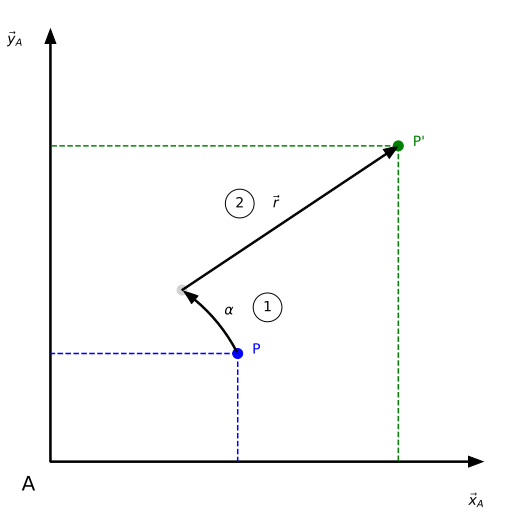
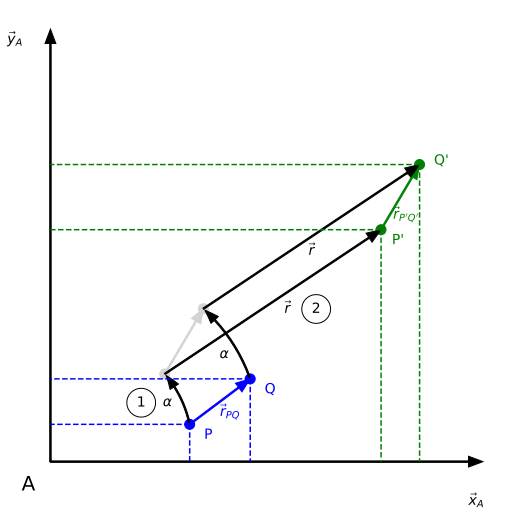
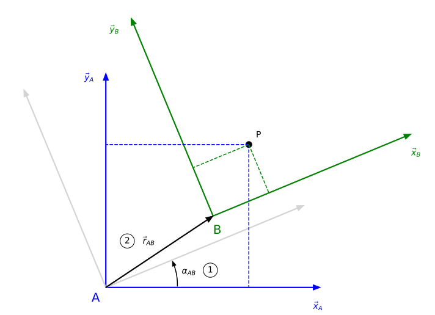
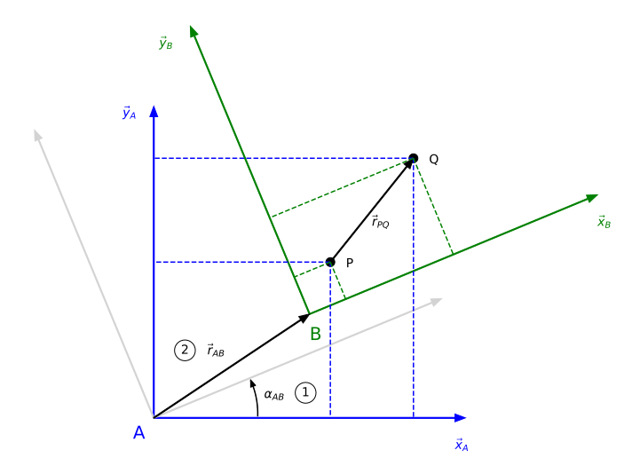

# Wrong Unit? Zero Points!

*wuzp* is a header-only C++20 library that adds compile-time checks for **units**, **coordinate systems** and **points vs. vectors** to the linear algebra libraries [Eigen](https://eigen.tuxfamily.org/) and [Blitz++](https://github.com/blitzpp/blitz), together with active and passive **transformations**.

[](https://opensource.org/licenses/MIT)
[](https://github.com/remod/wuzp/actions/workflows/ci.yml)
[](https://codecov.io/gh/remod/wuzp)
[](https://remod.github.io/wuzp/)

**Documentation: [remod.github.io/wuzp](https://remod.github.io/wuzp/)**

## What it catches

```cpp
Force force{mass}                    // Error: Units do not match.
Force force{mass * acceleration}     // OK.

force_in_A + force_in_B              // Error: Coordinate systems do not match.
force_in_A + X_AB.transform(force_in_B)  // OK.

point + point                        // Error: Two absolute objects cannot be summed.
point + (other - point) * 0.5        // OK: the midpoint.

innerProduct(velocity, velocity)     // Error: An inner product contracts an upper with a lower index, ...
innerProduct(force_covector, velocity)  // OK: the power F_i v^i.

X_AB * X_CB                          // Error: Adjacent frames do not match.
X_AB * X_BC                          // OK: X_AC, in Drake's monogram notation.
V_ABp == V_ABq                       // Error: Reference points do not match.
V_ABp.shift<Q>(p_PQ) == V_ABq        // OK: both are spatial velocities of the body B about the point Q.
jacobian.transform(joint_position)   // Error: A Jacobian maps vectors, not points: ...
```

Every element of a matrix has its own unit, so heterogeneous matrices such as a mass matrix with `kg` and `kg m^2` entries are checked too.
All checks happen at compile time: with Eigen, *wuzp* is as fast as plain Eigen ([benchmarks](benchmarks/README.md)).

## Example

```cpp
#include <iostream>

#include <wuzp/wuzp.hpp>
#include <wuzp_eigen/ValueMatrix.hpp>
#include <wuzp_units/Unit.hpp>

struct A {};
struct B {};
using CoordinateSystemA = wuzp::CoordinateSystem<A>;
using CoordinateSystemB = wuzp::CoordinateSystem<B>;
using ForceInA = wuzp::ForceVector3<wuzp_eigen::ValueMatrix, double, CoordinateSystemA>;
using ForceInB = wuzp::ForceVector3<wuzp_eigen::ValueMatrix, double, CoordinateSystemB>;
using PointInA = wuzp::PositionPoint3<wuzp_eigen::ValueMatrix, double, CoordinateSystemA>;
using PointInB = wuzp::PositionPoint3<wuzp_eigen::ValueMatrix, double, CoordinateSystemB>;
using X_BA = wuzp::PassiveProperRigidTransformation3<wuzp_eigen::ValueMatrix, CoordinateSystemA, CoordinateSystemB, double>;

int main() {
  const X_BA::Rotation rotation{1.0, 0.0, 0.0, 0.0, 0.0, 1.0, 0.0, -1.0, 0.0};  // B is A rotated by pi/2 around x.
  const X_BA::Translation translation{0.0, 0.0, -1.0};
  const X_BA transformation{rotation, translation};

  const ForceInA forceInA{1.0, 2.0, 3.0};
  const ForceInB forceInB{4.0, 5.0, 6.0};
  // const ForceInB sum = forceInA + forceInB;  // Error: Coordinate systems do not match.
  const ForceInB sum = transformation.transform(forceInA) + forceInB;  // A force is a vector: only rotated.

  const PointInA pointInA{1.0, 2.0, 3.0};
  const PointInB pointInB = transformation.transform(pointInA);  // A point is rotated and translated.
  std::cout << sum << "\n" << pointInB << std::endl;
  return 0;
}
```

More in the [examples](examples/), the [cookbook](https://remod.github.io/wuzp/cookbook/rigid-body-kinematics/) and the [unit tests](tests/src/).

## Installation

*wuzp* needs a C++20 compiler and CMake 3.22 or newer.
With CMake's FetchContent:

```cmake
include(FetchContent)
FetchContent_Declare(wuzp GIT_REPOSITORY https://github.com/remod/wuzp.git GIT_TAG master)
FetchContent_MakeAvailable(wuzp)
target_link_libraries(my_target PRIVATE wuzp::wuzp wuzp::eigen)
```

Or install it with `cmake -S wuzp -B wuzp/build && cmake --install wuzp/build` and use `find_package(wuzp CONFIG REQUIRED COMPONENTS eigen)` (see the [quickstart](https://remod.github.io/wuzp/quickstart/)).

The backends are optional components:

| Kind | Backends |
| --- | --- |
| Units | *wuzp*'s own (no dependency), [Boost.Units](https://www.boost.org/doc/libs/release/libs/units/) 1.74+, [mp-units](https://mpusz.github.io/mp-units/) 2.5+ |
| Linear algebra | [Eigen](https://eigen.tuxfamily.org/) 3.4 and 5, [Blitz++](https://github.com/blitzpp/blitz) 1.0.2+ |

*wuzp* is tested on Linux with GCC 11 to 15 and Clang 14 to 21, on macOS with Apple Clang, and on Windows with MSVC (on a best-effort basis), with every backend combination; mp-units only on Linux, with GCC 15 and Clang 21 (see [Backends](https://remod.github.io/wuzp/backends/)).

## Transformations

Rotations, translations and proper rigid transformations, each active and passive, Lorentz transformations and Jacobians.
They compose with `*` in the order of [Drake's monogram notation](https://drake.mit.edu/doxygen_cxx/group__multibody__notation.html), `X_AB * X_BC = X_AC`, and have an `inverse()`.
Rotations convert from and to quaternions, angle-axis, rotation vectors and Euler angles, with the manifold operations and the time derivatives of [kindr](https://github.com/ANYbotics/kindr).
Spatial velocities, accelerations and forces (twists and wrenches) also know the frame a motion is measured in and the point it is about, like [Drake's spatial vectors](https://drake.mit.edu/doxygen_cxx/group__multibody__spatial__vectors.html), and shift, compose and map by the adjoint of a rigid transformation with the transport formulas of rigid body kinematics (see [Spatial vectors](https://remod.github.io/wuzp/concepts/spatial-vectors/)).
Points are rotated and translated, vectors only rotated:

| | Point | Vector |
| --- | --- | --- |
| Active |  |  |
| Passive |  |  |

See [Transformations](https://remod.github.io/wuzp/concepts/transformations/) for how each tensor transforms, and the [conventions](https://remod.github.io/wuzp/conventions/) with their sources.

## Documentation

* [Quickstart](https://remod.github.io/wuzp/quickstart/), [concepts](https://remod.github.io/wuzp/concepts/units/), [backends](https://remod.github.io/wuzp/backends/), [cookbook](https://remod.github.io/wuzp/cookbook/rigid-body-kinematics/), [conventions](https://remod.github.io/wuzp/conventions/), [comparison with mp-units and Boost.Units](https://remod.github.io/wuzp/comparison/), [limitations](https://remod.github.io/wuzp/limitations/) and the [API reference](https://remod.github.io/wuzp/api/).
* [DESIGN.md](DESIGN.md): the design decisions, with the sources of the conventions and a review of the mathematical and physical soundness.
* [CHANGELOG.md](CHANGELOG.md): the changes of each release.

## Contributing

Contributions are welcome! [CONTRIBUTING.md](CONTRIBUTING.md) describes the development environment, the tests and the CI, and how to write a backend.

*wuzp* is licensed under the [MIT License](LICENSE.md).
