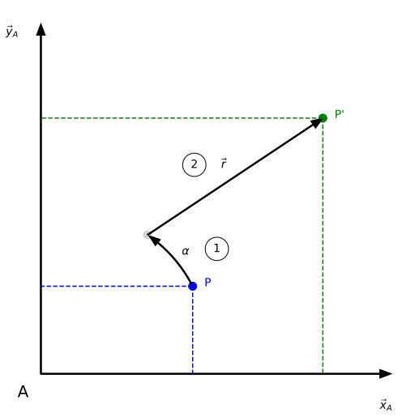
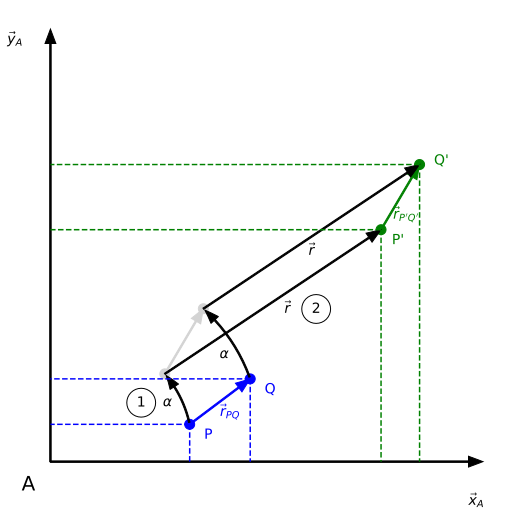
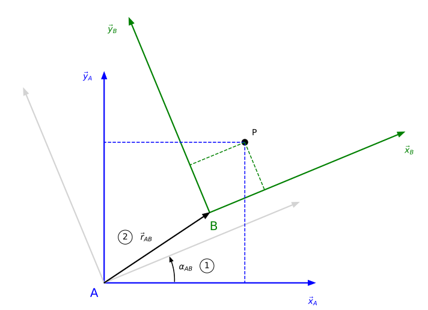
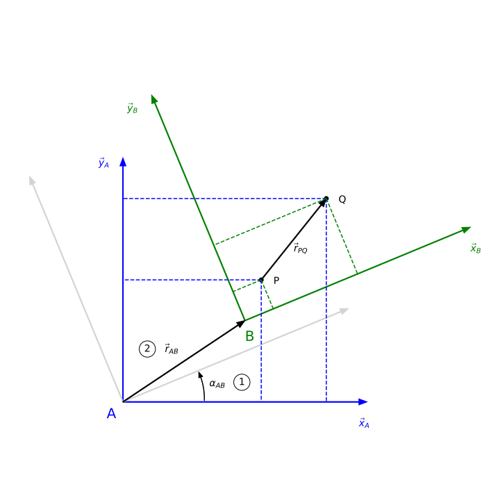

# Wrong Unit? Zero Points!

*wuzp* is a C++20 library which extends existing numeric algebra libraries with

* unit type safety,
* coordinate system type safety, and
* transformations.

[](https://opensource.org/licenses/MIT)
[](https://github.com/remod/wuzp/actions/workflows/ci.yml)
[](https://codecov.io/gh/remod/wuzp)

## Type Safety

Type safety speeds up development because your IDE, your compiler will report any mistakes without you having to write and run unit tests.

*wuzp* provides compile time type safety for units and coordinate systems.

It prevents errors like mixing quantities with incompatible units ([code example](examples/quantity.cpp)):

```cpp
force = mass  // Error: Mismatching units!
force = mass * acceleration  // OK.
```

While relative quantities can be operated on freely, there are some restrictions for absolute quantities.[^1]
For example, it does not make sense to add two absolute quantities ([code example](examples/absolute_quantity.cpp)):

```cpp
time_point + time_point  // Error: Cannot add two absolute quantities!
time_point + duration  // OK.
```

When operating with different coordinate systems, it is crucial to prevent mixing them up:

```cpp
force_in_A + force_in_B  // Error: Mismatching coordinate systems!
force_in_A + transformation_B_to_A.transform(force_in_B)  // OK.
```

**Note:** While a single object can only have a single coordinate system, it is possible to assign it a heterogeneous set of units.
This is required e.g. to represent mass matrices, which contain `kg` for translational degrees of freedom and `kg m^2` for rotational degrees of freedom.

## Transformations

In general, a transformation can be one or a combination of the following base transformations:

* Rotation
* Translation
* Reflection
* Dilation

*wuzp* supports the following transformations as of today:

* Rotation
* Translation
* Proper rigid transformation (= first rotation, then translation)
* Jacobian
* Lorentz transformation

These transformations are supported in their **active** and **passive** form.
In the **active** case the object is transformed, resulting in a new object.
In the **passive** case there is only a single object, but the coordinate system which it is expressed in is transformed.[^2]

As mentioned above, *wuzp* distinguishes between absolute and relative quantities.
In geometric terms, absolute positions can be interpreted as points, while relative positions can be interpreted as vectors.
This distinction becomes important when transforming points and vectors:
Unlike points, vectors are agnostic to their position and therefore unaffectd by translations.

The following table visualizes how a proper rigid transformation transforms a point and a vector in the active and passive case:

| | Target: Point | Target: Vector |
| --- | --- | --- |
| Type:<br>Active | <br>P is first rotated, then translated into P'. | <br>*r* is first rotated, then translated into *r'*. As a vector is agnostic to its position, only the rotational part of the transformation affects its components. |
| Type:<br>Passive | <br>P is expressed in coordinate system A, then in coordinate system B. | <br>*r* is expressed in coordinate system A, then in coordinate system B. As a vector is agnostic to its position, only the rotational part of the transformation affects its components. |

## Installation & Usage

*wuzp* integrates with the following unit and linear algebra libraries:

**Units:** 

* *wuzp*' own implementation
* [Boost](https://www.boost.org/doc/libs/1_61_0/doc/html/boost_units.html)

**Linear Algebra:**

* [Eigen](http://eigen.tuxfamily.org/)
* [Blitz++](https://github.com/blitzpp/blitz)

*wuzp* is header-only and requires a C++20 compiler and CMake 3.22 or newer.
Each backend is an optional component with its own dependency:

| Component | Target | Dependency (minimum version) |
| --- | --- | --- |
| core, including *wuzp*' own units | `wuzp::wuzp` | none |
| `eigen` | `wuzp::eigen` | Eigen 3.4 |
| `blitz` | `wuzp::blitz` | Blitz++ 1.0.2 |
| `boost` | `wuzp::boost` | Boost 1.74 |

**Using CMake's FetchContent:**

```cmake
include(FetchContent)
FetchContent_Declare(wuzp GIT_REPOSITORY https://github.com/remod/wuzp.git GIT_TAG master)
FetchContent_MakeAvailable(wuzp)
target_link_libraries(my_target PRIVATE wuzp::wuzp wuzp::eigen)
```

**Installing and using `find_package`:**

```bash
git clone https://github.com/remod/wuzp.git
cmake -S wuzp -B wuzp/build
cmake --install wuzp/build  # Installs the components whose dependencies were found.
```

```cmake
find_package(wuzp CONFIG REQUIRED COMPONENTS eigen)
target_link_libraries(my_target PRIVATE wuzp::wuzp wuzp::eigen)
```

By default, a backend is enabled if its dependency is found.
Use `-DWUZP_WITH_EIGEN=ON|OFF` (and likewise `BLITZ`, `BOOST`) to require or disable one.

## Examples

Examples demonstrating how to use *wuzp* can be found in the `examples` folder.
They are built together with the project if the Eigen backend is enabled, e.g.:

```bash
cmake --preset gcc-wuzp-eigen
cmake --build --preset gcc-wuzp-eigen
./build/gcc-wuzp-eigen/examples/example_transformation
```

For more example code, have a look at the unit tests in the `tests` folder.

## Limitations

Tensors may only be 0-, 1-, or 2-dimensional.

Do not use the keyword `auto` when using the Eigen implementation (see [documentation](https://eigen.tuxfamily.org/dox/TopicPitfalls.html)).

Blitz++ cannot be installed with `libblitz0-dev` when compiled with Clang, because the Debian package does not contain a required header file.
Instead, it needs to be cloned from GitHub and then built and installed manually (see [GitHub issue](https://github.com/blitzpp/blitz/issues/177)).

## Contributing

**Building and testing**

The test suite runs against every combination of units backend and value matrix backend, to make sure *wuzp* does not depend on one particular implementation.
Each combination has a CMake preset named `<compiler>-<units>-<values>`, e.g. `gcc-wuzp-eigen` or `clang-boost-blitz` (see `cmake --list-presets`):

```bash
ci/install_dependencies.sh gcc eigen  # On Ubuntu; installs the compiler and dependencies.
cmake --preset gcc-wuzp-eigen
cmake --build --preset gcc-wuzp-eigen
ctest --preset gcc-wuzp-eigen
```

When adding a new feature, please make sure to add unit tests for it, including tests verifying that invalid code does not compile.

**Formatting and tidying**

The code is formatted using [clang-format](https://clang.llvm.org/docs/ClangFormat.html) and checked with [clang-tidy](https://clang.llvm.org/extra/clang-tidy/):

```bash
cmake --build --preset gcc-wuzp-eigen --target wuzp_format
cmake --build --preset gcc-wuzp-eigen --target wuzp_tidy
```

**Continuous integration**

The CI workflow checks the format, runs the tests for all backend combinations with GCC and Clang on the oldest supported and a recent Ubuntu LTS, measures code coverage, and tests the installed package.

[^1]: Inspired by [Boost units](https://www.boost.org/doc/libs/1_61_0/doc/html/boost_units/Examples.html#boost_units.Examples.AbsoluteRelativeTemperatureExample).

[^2]: The difference between active and passive transformations is explained [here](https://en.wikipedia.org/wiki/Active_and_passive_transformation).