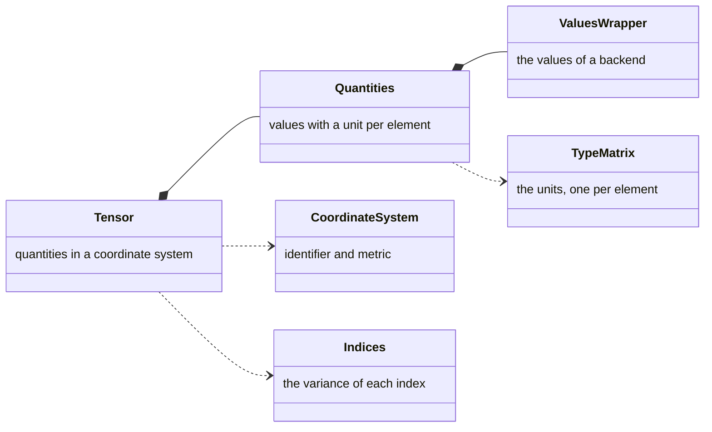
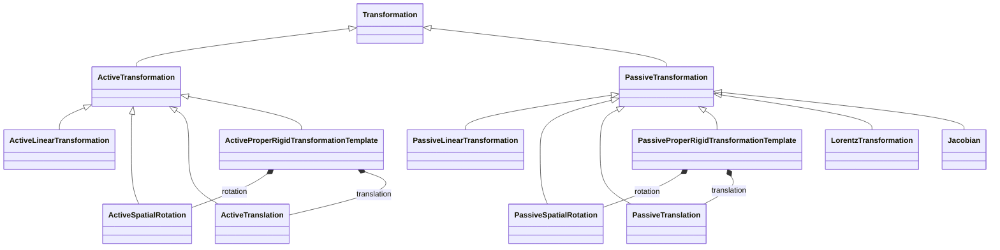

# Class hierarchy

## Values, quantities and tensors

A tensor holds quantities, which hold the values of a value matrix backend and a matrix of units:

* `wuzp_eigen::ValueMatrix<Value, Rows, Cols>` and `wuzp_blitz::ValueMatrix` are `ValuesWrapper`s of the arrays of their libraries.
* `Quantity<Values, Unit>` is `Quantities` of a 1x1 matrix with one unit, and `wuzp_eigen::QuantityD<Unit>` a quantity with a `double` value.
* `Vector`, `Covector`, `Point` and the other tensor aliases, e.g. `PositionPoint3` or `ForceCovector3`, are `Tensor`s with fixed indices and absoluteness.
* The unit types and the coordinate systems are tags: they exist only at compile time.

## Transformations

Every transformation derives from `ActiveTransformation` or `PassiveTransformation`, which provide `transform()`, composition with `*` and `inverse()` through the [CRTP](https://en.cppreference.com/w/cpp/language/crtp), and these from `Transformation<DerivedT_>`, whose destructor is protected and not virtual: transformations are values, never deleted through a pointer to the base.
The base is a template of the transformation, so that a proper rigid transformation and its rotation have different empty bases, which take no space: a proper rigid transformation is as large as its rotation and its translation.
`AnyTransformation` tells whether a type is a transformation.

* `ActiveProperRigidTransformation3` and `PassiveProperRigidTransformation3` are the templates of proper rigid transformations with a spatial rotation and a spatial translation, `ActiveSpatialTranslation3` and `PassiveSpatialTranslation3` translations in units of length.
* The rotations and the Lorentz transformations transform the same tensors as the linear transformations with their matrices, whose traits they inherit, but have structural inverses and check their validity in debug builds.
* Which tensors a transformation transforms, and which compositions exist, is decided by the traits `TransformationTraits` and `CompositionTraits`, not by virtual functions (see [Transformations](concepts/transformations.md)).

## Backends

The core reaches the libraries only through traits, e.g. `Sum`, `Transpose` or `Coefficient`, which the backends specialize for `AccessImplementation<Implementation>`, and through `AccessUnits` for the units.
The concepts `ValueMatrixBackend`, `InvertibleValueMatrixBackend` and `UnitSystem` check that a backend provides them (see [Backends](backends.md)).
