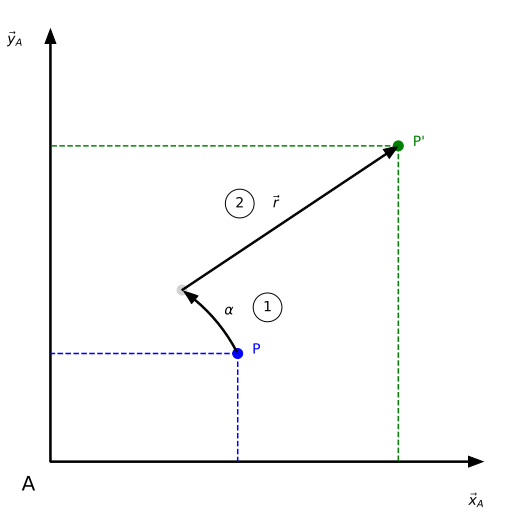
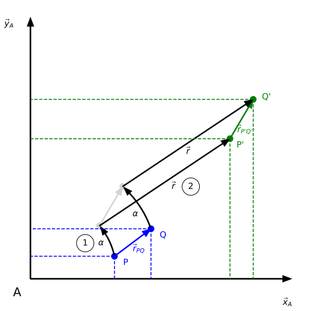
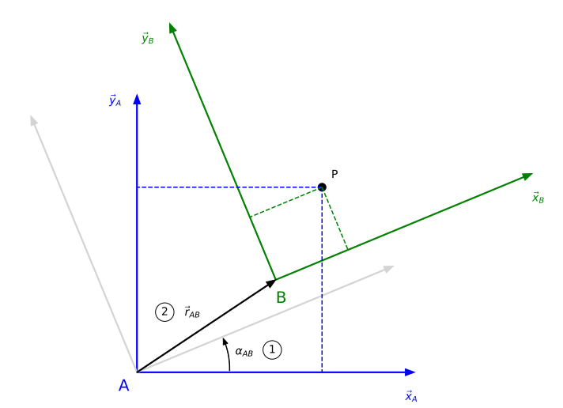
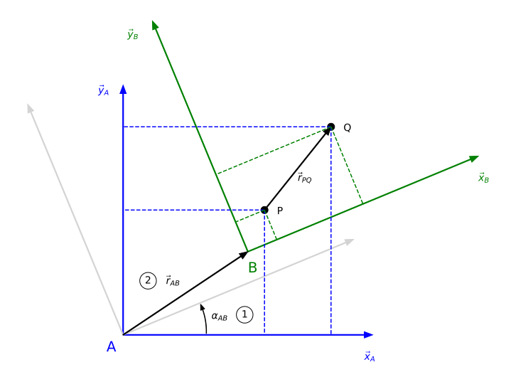

# Points and vectors

A tensor is *absolute*, a point, or *relative*, e.g. a vector.
Points follow the rules of affine spaces, like [CGAL's points and vectors](https://doc.cgal.org/latest/Kernel_23/index.html), [mp-units' quantity points](https://mpusz.github.io/mp-units/latest/users_guide/framework_basics/the_affine_space/) and Boost.Units' absolute quantities: only the operations whose result does not depend on the origin of the coordinate system compile.

```cpp
using Position = wuzp::PositionPoint3<wuzp_eigen::ValueMatrix, double, WorldFrame>;
using Displacement = wuzp::PositionVector3<wuzp_eigen::ValueMatrix, double, WorldFrame>;

const Position p{1.0, 2.0, 3.0};
const Position q{3.0, 2.0, 1.0};
const Displacement v = q - p;           // OK: the difference of two points is a vector.
const Position r = p + v;               // OK: a point plus a vector is a point.
const Position midpoint = p + (q - p) * 0.5;  // OK: an affine combination.
// p + q;                               // Error: Two absolute objects cannot be summed.
// p * 2.0;                             // Error: An absolute object cannot appear in a multiplication.
```

| Operation | Result |
| --- | --- |
| point + vector, vector + point, point - vector | point |
| point - point | vector |
| point + point, vector - point | error |
| affine combination, e.g. the midpoint `p + (q - p) * 0.5` | point |
| `makeRelative(point)` | the vector `p - o` from the origin `o`, with the components of the point |
| `makeAbsolute(vector)` | the point `o + v`, with the components of the vector |
| negation, product with a scalar or a quantity, quotient by them | error for points |
| dot, inner, outer and cross product, `cwiseProduct`, `cwiseQuotient` | error for points |
| norm, `inverse()`, `cwiseInverse()`, transpose | error for points |

Points and vectors do not convert into each other implicitly: `makeRelative()` and `makeAbsolute()` make the origin explicit.
The rule behind the table is that a result must be invariant under translations of the origin, in the terms of Atkey, Johann and Kennedy, ["Abstraction and invariance for algebraically indexed types"](https://doi.org/10.1145/2429069.2429082) (POPL 2013).

## What can be a point

Only a tensor with one upper index, a vector or a batch of vectors, can be absolute: a covector pairs with vectors, not with points.
The aliases with *Point* in their name are points, e.g. `PositionPoint3`, `SpacetimePoint4` and `TimePoint`, and those with *Vector* are vectors.
A tensor with an upper index may also store a batch of points, one per column, e.g. a point cloud, which transformations transform at once.

## Absolute scalars

An absolute scalar, e.g. a time point, is a point in a one-dimensional coordinate system whose origin is its zero, e.g. an epoch ([code example](https://github.com/remod/wuzp/blob/master/examples/absolute_quantity.cpp)):

```cpp
struct Epoch {};
using EpochFrame = wuzp::CoordinateSystem<Epoch>;
using TimePoint = wuzp::TimePoint<wuzp_eigen::ValueMatrix, double, EpochFrame>;
using Duration = wuzp::Duration<wuzp_eigen::ValueMatrix, double, EpochFrame>;

const TimePoint start{2.0};
const TimePoint end = start + Duration{3.0};
const Duration elapsed = end - start;
// start + end;  // Error: Two absolute objects cannot be summed.
```

The SI defines the Celsius temperature the same way, `t = T - T0` with `T0 = 273.15 K` ([SI Brochure](https://www.bipm.org/en/publications/si-brochure), section 2.3.1), and `std::chrono` gives its time points a clock.
A change of the origin, e.g. of the epoch, is a one-dimensional translation (see [Transformations](transformations.md)).

## Transformations of points and vectors

The distinction matters for transformations: translations move points, and leave vectors unchanged, since a vector has no position.
A proper rigid transformation therefore rotates and translates a point, and only rotates a vector:

| | Point | Vector |
| --- | --- | --- |
| Active | { width="300" }<br>P is first rotated, then translated into P'. | { width="300" }<br>Only the rotation changes the components of *r*. |
| Passive | { width="300" }<br>P is expressed in A, then in B. | { width="300" }<br>Only the rotation changes the components of *r*. |

See the [design notes](https://github.com/remod/wuzp/blob/master/DESIGN.md#points-and-vectors) for the reasons behind these rules.
